# INFERXE – Supabase Database Audit (read-only)

_Audit date: 2026-11-18. Scope: the `public` schema of the Supabase project configured in the repository `.env`._  
_Method: a forced read-only session (`transaction_read_only = on`) that read system catalogs and statistics only. **No table rows were read, and nothing was created, altered, dropped or written.** The backend mapping is a static scan of the repository code._

**Legend:** ✅ Confirmed (read from the database catalog or code) · 🔎 Inferred (reasoned from schema and code, not proven) · ⛔ Unavailable (not readable through SQL or not accessible)

## Critical finding (act on this first)

✅ **9 tables have Row Level Security turned off, and the `anon` and `authenticated` roles hold full privileges on them** (SELECT, INSERT, UPDATE, DELETE, TRUNCATE, REFERENCES, TRIGGER):

- `gpu_deployments` (about 0 rows)
- `gpu_inventory` (about 0 rows)
- `gpu_maintenance_schedules` (about 0 rows)
- `notebook_instances` (about 0 rows)
- `notification_outbox` (about 155 rows)
- `ssh_keys` (about 0 rows)
- `users` (about 192 rows)
- `wallets` (about 128 rows)
- `workspace_settings` (about 3 rows)

Supabase exposes the `public` schema through its REST API (PostgREST), and the `anon` key is public by design. So anyone who has the project URL and that key could read `users` (names and emails), **change wallet balances in `wallets`**, read or alter `ssh_keys`, `workspace_settings` and the outbox, or truncate any of these tables.

🔎 These are the tables created by the Python services' own setup code (`notifications/db.py` `init_db` and the inference SQLAlchemy models) rather than by the Supabase-managed schema. That is most likely why they missed the RLS setup the other tables have.

**Recommended fix (not applied; this audit is read-only):** run `ALTER TABLE … ENABLE ROW LEVEL SECURITY` on each table, and/or `REVOKE ALL … FROM anon, authenticated`. The backends connect as the table owner or with the service role, both of which bypass RLS, so they should keep working. Confirm that before applying.

Exploitability through PostgREST was **not tested**: that would have meant using the anon key against production.

## 1. Database overview

| Item | Value |
|---|---|
| PostgreSQL version | ✅ 17.11 |
| Tables in `public` | ✅ 33: all 33 expected tables are present, with no additional tables and no views |
| Total size (tables and indexes) | ✅ 2.1 MB |
| Functions | ✅ `bump_admin_session_version`, `set_updated_at`, `sync_customer_profile` |
| `max_connections` | ✅ 60 |
| Connections at audit time | ✅ idle: 10, (none): 1, active: 1 |
| Supavisor pool size and plan tier | ⛔ dashboard only (not readable through SQL) |
| Pooler mode | 🔎 session mode (the backend connection uses the pooler host on port 5432) |

✅ **Two families of tables coexist**, confirmed from column types and where their DDL comes from:

- **Supabase-managed schema:** uuid ids, `timestamptz` columns, foreign keys to `profiles`, RLS on, and `set_updated_at` triggers on most. Tables: `profiles`, `organizations`, `organization_members`, `api_keys`, `inference_requests`, `deployments`, `notebook_sessions`, `ssh_public_keys`, `gpu_providers`, `gpu_listings`, `orders`, `order_reviews`, `usage_records`, `wallet_accounts`, `wallet_transactions`, `notifications`, `user_access_policies`, `saved_gpu_listings`, `audit_logs`, `chat_history`, `document_metadata`, `admin_users`, `admin_sessions`, `inferxe_notifications`.
- **Service-created tables:** varchar ids, timestamps stored as text, no foreign keys, RLS off. From `backend/notifications/db.py` and `service.py`: `users`, `wallets`, `gpu_deployments`, `gpu_inventory`, `gpu_maintenance_schedules`, `notification_outbox`, `workspace_settings`. From the inference SQLAlchemy models (`backend/inference/models.py`): `ssh_keys`, `notebook_instances`.

## 2. Complete table and column inventory

Defaults are shown exactly as stored in the catalog.

### `admin_sessions`

About 7 rows · 40 kB · RLS **on** · policies: 0

| Column | Type | Null | Default |
|---|---|---|---|
| `id` | uuid | NOT NULL |  |
| `admin_user_id` | uuid | NOT NULL |  |
| `session_version` | bigint | NOT NULL |  |
| `expires_at` | timestamptz | NOT NULL |  |
| `created_at` | timestamptz | NOT NULL | now() |
| `revoked_at` | timestamptz |  |  |

| Constraint | Kind | Definition |
|---|---|---|
| `admin_sessions_expiration_after_creation` | CHECK | CHECK ((expires_at > created_at)) |
| `admin_sessions_admin_user_id_fkey` | FOREIGN KEY | FOREIGN KEY (admin_user_id) REFERENCES admin_users(id) ON DELETE CASCADE |
| `admin_sessions_pkey` | PRIMARY KEY | PRIMARY KEY (id) |

### `admin_users`

About 1 rows · 64 kB · RLS **on** · policies: 0 · triggers: admin_users_update_session_version

| Column | Type | Null | Default |
|---|---|---|---|
| `id` | uuid | NOT NULL | gen_random_uuid() |
| `email` | text | NOT NULL |  |
| `password_hash` | text | NOT NULL |  |
| `is_active` | boolean | NOT NULL | true |
| `session_version` | bigint | NOT NULL | 1 |
| `created_at` | timestamptz | NOT NULL | now() |
| `updated_at` | timestamptz | NOT NULL | now() |
| `last_login` | timestamptz |  |  |

| Constraint | Kind | Definition |
|---|---|---|
| `admin_users_email_normalized` | CHECK | CHECK ((email = lower(btrim(email)))) |
| `admin_users_session_version_check` | CHECK | CHECK ((session_version > 0)) |
| `admin_users_pkey` | PRIMARY KEY | PRIMARY KEY (id) |

### `api_keys`

About 6 rows · 64 kB · RLS **on** · policies: 0

| Column | Type | Null | Default |
|---|---|---|---|
| `id` | uuid | NOT NULL | gen_random_uuid() |
| `user_id` | text | NOT NULL |  |
| `organization_id` | uuid |  |  |
| `name` | text | NOT NULL |  |
| `key_prefix` | text | NOT NULL |  |
| `secret_hash` | text | NOT NULL |  |
| `created_at` | timestamptz | NOT NULL | now() |
| `last_used_at` | timestamptz |  |  |
| `expires_at` | timestamptz |  |  |
| `revoked_at` | timestamptz |  |  |
| `status` | text | NOT NULL | 'active'::text |

| Constraint | Kind | Definition |
|---|---|---|
| `api_keys_status_check` | CHECK | CHECK ((status = ANY (ARRAY['active'::text, 'revoked'::text, 'expired'::text]))) |
| `api_keys_organization_id_fkey` | FOREIGN KEY | FOREIGN KEY (organization_id) REFERENCES organizations(id) ON DELETE SET NULL |
| `api_keys_user_id_fkey` | FOREIGN KEY | FOREIGN KEY (user_id) REFERENCES profiles(user_id) ON DELETE CASCADE |
| `api_keys_pkey` | PRIMARY KEY | PRIMARY KEY (id) |

### `audit_logs`

About 0 rows · 24 kB · RLS **on** · policies: 0

| Column | Type | Null | Default |
|---|---|---|---|
| `id` | uuid | NOT NULL | gen_random_uuid() |
| `actor_user_id` | text |  |  |
| `organization_id` | uuid |  |  |
| `action` | text | NOT NULL |  |
| `target_type` | text |  |  |
| `target_id` | text |  |  |
| `details` | jsonb | NOT NULL | '{}'::jsonb |
| `created_at` | timestamptz | NOT NULL | now() |

| Constraint | Kind | Definition |
|---|---|---|
| `audit_logs_actor_user_id_fkey` | FOREIGN KEY | FOREIGN KEY (actor_user_id) REFERENCES profiles(user_id) ON DELETE SET NULL |
| `audit_logs_organization_id_fkey` | FOREIGN KEY | FOREIGN KEY (organization_id) REFERENCES organizations(id) ON DELETE SET NULL |
| `audit_logs_pkey` | PRIMARY KEY | PRIMARY KEY (id) |

### `chat_history`

About 57 rows · 160 kB · RLS **on** · policies: 1

| Column | Type | Null | Default |
|---|---|---|---|
| `id` | uuid | NOT NULL | gen_random_uuid() |
| `session_id` | text | NOT NULL |  |
| `user_id` | text |  |  |
| `organization_id` | uuid |  |  |
| `question` | text | NOT NULL |  |
| `answer` | text | NOT NULL |  |
| `grounded` | boolean |  | true |
| `status` | text |  | 'success'::text |
| `sources` | jsonb | NOT NULL | '[]'::jsonb |
| `processing_time_ms` | integer |  | 0 |
| `metadata` | jsonb | NOT NULL | '{}'::jsonb |
| `created_at` | timestamptz | NOT NULL | timezone('utc'::text, now()) |

| Constraint | Kind | Definition |
|---|---|---|
| `chat_history_organization_id_fkey` | FOREIGN KEY | FOREIGN KEY (organization_id) REFERENCES organizations(id) ON DELETE SET NULL |
| `chat_history_user_id_fkey` | FOREIGN KEY | FOREIGN KEY (user_id) REFERENCES profiles(user_id) ON DELETE SET NULL |
| `chat_history_pkey` | PRIMARY KEY | PRIMARY KEY (id) |

### `deployments`

About 0 rows · 32 kB · RLS **on** · policies: 0 · triggers: set_updated_at

| Column | Type | Null | Default |
|---|---|---|---|
| `id` | uuid | NOT NULL | gen_random_uuid() |
| `user_id` | text | NOT NULL |  |
| `organization_id` | uuid |  |  |
| `listing_id` | uuid |  |  |
| `name` | text | NOT NULL |  |
| `model_name` | text | NOT NULL |  |
| `gpu_model` | text | NOT NULL |  |
| `region` | text |  |  |
| `status` | text | NOT NULL | 'provisioning'::text |
| `hourly_rate` | numeric | NOT NULL | 0 |
| `provider_instance_id` | text |  |  |
| `endpoint_url` | text |  |  |
| `started_at` | timestamptz |  |  |
| `stopped_at` | timestamptz |  |  |
| `metadata` | jsonb | NOT NULL | '{}'::jsonb |
| `created_at` | timestamptz | NOT NULL | now() |
| `updated_at` | timestamptz | NOT NULL | now() |

| Constraint | Kind | Definition |
|---|---|---|
| `deployments_hourly_rate_check` | CHECK | CHECK ((hourly_rate >= (0)::numeric)) |
| `deployments_status_check` | CHECK | CHECK ((status = ANY (ARRAY['provisioning'::text, 'running'::text, 'stopped'::text, 'completed'::text, 'failed'::text, 'cancelled'::text]))) |
| `deployments_listing_id_fkey` | FOREIGN KEY | FOREIGN KEY (listing_id) REFERENCES gpu_listings(id) ON DELETE SET NULL |
| `deployments_organization_id_fkey` | FOREIGN KEY | FOREIGN KEY (organization_id) REFERENCES organizations(id) ON DELETE SET NULL |
| `deployments_user_id_fkey` | FOREIGN KEY | FOREIGN KEY (user_id) REFERENCES profiles(user_id) ON DELETE RESTRICT |
| `deployments_pkey` | PRIMARY KEY | PRIMARY KEY (id) |

### `document_metadata`

About 4 rows · 128 kB · RLS **on** · policies: 1

| Column | Type | Null | Default |
|---|---|---|---|
| `id` | uuid | NOT NULL | gen_random_uuid() |
| `document_id` | text | NOT NULL |  |
| `filename` | text | NOT NULL |  |
| `file_type` | text |  |  |
| `file_size_bytes` | bigint |  |  |
| `file_hash` | text |  |  |
| `status` | text |  | 'processed'::text |
| `chunk_count` | integer |  | 0 |
| `uploaded_by` | text |  |  |
| `organization_id` | uuid |  |  |
| `metadata` | jsonb | NOT NULL | '{}'::jsonb |
| `created_at` | timestamptz | NOT NULL | timezone('utc'::text, now()) |
| `updated_at` | timestamptz | NOT NULL | timezone('utc'::text, now()) |

| Constraint | Kind | Definition |
|---|---|---|
| `document_metadata_organization_id_fkey` | FOREIGN KEY | FOREIGN KEY (organization_id) REFERENCES organizations(id) ON DELETE SET NULL |
| `document_metadata_uploaded_by_fkey` | FOREIGN KEY | FOREIGN KEY (uploaded_by) REFERENCES profiles(user_id) ON DELETE SET NULL |
| `document_metadata_pkey` | PRIMARY KEY | PRIMARY KEY (id) |
| `document_metadata_document_id_key` | UNIQUE | UNIQUE (document_id) |

### `gpu_deployments`

About 0 rows · 24 kB · RLS **off** · policies: 0

| Column | Type | Null | Default |
|---|---|---|---|
| `id` | varchar(64) | NOT NULL |  |
| `user_id` | varchar(128) | NOT NULL |  |
| `name` | varchar(128) | NOT NULL |  |
| `model` | varchar(128) | NOT NULL |  |
| `gpu` | varchar(64) | NOT NULL |  |
| `vram` | varchar(64) | NOT NULL |  |
| `region` | varchar(128) | NOT NULL |  |
| `hourly_rate` | numeric | NOT NULL |  |
| `status` | varchar(32) | NOT NULL | 'Provisioning'::character varying |
| `error_message` | text |  |  |
| `idempotency_key` | varchar(255) |  |  |
| `created_at` | text | NOT NULL |  |
| `updated_at` | text | NOT NULL |  |

| Constraint | Kind | Definition |
|---|---|---|
| `gpu_deployments_pkey` | PRIMARY KEY | PRIMARY KEY (id) |

### `gpu_inventory`

About 0 rows · 16 kB · RLS **off** · policies: 0

| Column | Type | Null | Default |
|---|---|---|---|
| `id` | varchar(64) | NOT NULL |  |
| `name` | varchar(128) | NOT NULL |  |
| `gpu_model` | varchar(128) | NOT NULL |  |
| `vram` | varchar(64) | NOT NULL |  |
| `region` | varchar(128) | NOT NULL |  |
| `price` | numeric | NOT NULL |  |
| `currency` | varchar(16) | NOT NULL | 'INR'::character varying |
| `billing_unit` | varchar(32) | NOT NULL | 'hr'::character varying |
| `updated_at` | text | NOT NULL |  |

| Constraint | Kind | Definition |
|---|---|---|
| `gpu_inventory_pkey` | PRIMARY KEY | PRIMARY KEY (id) |

### `gpu_listings`

About 0 rows · 24 kB · RLS **on** · policies: 0 · triggers: set_updated_at

| Column | Type | Null | Default |
|---|---|---|---|
| `id` | uuid | NOT NULL | gen_random_uuid() |
| `provider_id` | uuid |  |  |
| `name` | text | NOT NULL |  |
| `gpu_model` | text | NOT NULL |  |
| `vram` | text |  |  |
| `architecture` | text |  |  |
| `bandwidth` | text |  |  |
| `tflops` | text |  |  |
| `region` | text |  |  |
| `quantity` | integer | NOT NULL | 0 |
| `hourly_price` | numeric | NOT NULL | 0 |
| `currency` | character | NOT NULL | 'INR'::bpchar |
| `status` | text | NOT NULL | 'available'::text |
| `created_at` | timestamptz | NOT NULL | now() |
| `updated_at` | timestamptz | NOT NULL | now() |

| Constraint | Kind | Definition |
|---|---|---|
| `gpu_listings_hourly_price_check` | CHECK | CHECK ((hourly_price >= (0)::numeric)) |
| `gpu_listings_quantity_check` | CHECK | CHECK ((quantity >= 0)) |
| `gpu_listings_status_check` | CHECK | CHECK ((status = ANY (ARRAY['available'::text, 'paused'::text, 'maintenance'::text, 'unavailable'::text]))) |
| `gpu_listings_provider_id_fkey` | FOREIGN KEY | FOREIGN KEY (provider_id) REFERENCES gpu_providers(id) ON DELETE SET NULL |
| `gpu_listings_pkey` | PRIMARY KEY | PRIMARY KEY (id) |

### `gpu_maintenance_schedules`

About 0 rows · 16 kB · RLS **off** · policies: 0

| Column | Type | Null | Default |
|---|---|---|---|
| `id` | varchar(64) | NOT NULL |  |
| `cluster_region` | varchar(128) | NOT NULL |  |
| `gpu_model` | varchar(128) |  |  |
| `window_start` | text | NOT NULL |  |
| `window_end` | text | NOT NULL |  |
| `reason` | text | NOT NULL |  |
| `status` | varchar(32) | NOT NULL | 'SCHEDULED'::character varying |
| `scheduled_by` | varchar(128) |  |  |
| `created_at` | text | NOT NULL |  |

| Constraint | Kind | Definition |
|---|---|---|
| `gpu_maintenance_schedules_pkey` | PRIMARY KEY | PRIMARY KEY (id) |

### `gpu_providers`

About 0 rows · 24 kB · RLS **on** · policies: 0 · triggers: set_updated_at

| Column | Type | Null | Default |
|---|---|---|---|
| `id` | uuid | NOT NULL | gen_random_uuid() |
| `name` | text | NOT NULL |  |
| `slug` | text |  |  |
| `region` | text |  |  |
| `status` | text | NOT NULL | 'active'::text |
| `integration_metadata` | jsonb | NOT NULL | '{}'::jsonb |
| `created_at` | timestamptz | NOT NULL | now() |
| `updated_at` | timestamptz | NOT NULL | now() |

| Constraint | Kind | Definition |
|---|---|---|
| `gpu_providers_status_check` | CHECK | CHECK ((status = ANY (ARRAY['active'::text, 'inactive'::text, 'pending'::text, 'maintenance'::text]))) |
| `gpu_providers_pkey` | PRIMARY KEY | PRIMARY KEY (id) |
| `gpu_providers_slug_key` | UNIQUE | UNIQUE (slug) |

### `inference_requests`

About 0 rows · 24 kB · RLS **on** · policies: 0

| Column | Type | Null | Default |
|---|---|---|---|
| `id` | uuid | NOT NULL | gen_random_uuid() |
| `user_id` | text |  |  |
| `organization_id` | uuid |  |  |
| `api_key_id` | uuid |  |  |
| `deployment_id` | uuid |  |  |
| `model_name` | text |  |  |
| `provider_name` | text |  |  |
| `input_tokens` | bigint | NOT NULL | 0 |
| `output_tokens` | bigint | NOT NULL | 0 |
| `latency_ms` | integer |  |  |
| `status` | text | NOT NULL | 'pending'::text |
| `error_message` | text |  |  |
| `cost` | numeric | NOT NULL | 0 |
| `created_at` | timestamptz | NOT NULL | now() |

| Constraint | Kind | Definition |
|---|---|---|
| `inference_requests_status_check` | CHECK | CHECK ((status = ANY (ARRAY['pending'::text, 'success'::text, 'failed'::text]))) |
| `inference_requests_api_key_id_fkey` | FOREIGN KEY | FOREIGN KEY (api_key_id) REFERENCES api_keys(id) ON DELETE SET NULL |
| `inference_requests_deployment_id_fkey` | FOREIGN KEY | FOREIGN KEY (deployment_id) REFERENCES deployments(id) ON DELETE SET NULL |
| `inference_requests_organization_id_fkey` | FOREIGN KEY | FOREIGN KEY (organization_id) REFERENCES organizations(id) ON DELETE SET NULL |
| `inference_requests_user_id_fkey` | FOREIGN KEY | FOREIGN KEY (user_id) REFERENCES profiles(user_id) ON DELETE SET NULL |
| `inference_requests_pkey` | PRIMARY KEY | PRIMARY KEY (id) |

### `inferxe_notifications`

About 0 rows · 40 kB · RLS **on** · policies: 0

| Column | Type | Null | Default |
|---|---|---|---|
| `id` | uuid | NOT NULL | gen_random_uuid() |
| `user_id` | text | NOT NULL |  |
| `title` | text | NOT NULL |  |
| `message` | text | NOT NULL |  |
| `notification_type` | text |  | 'general'::text |
| `delivery_channel` | text |  | 'in_app'::text |
| `delivery_status` | text | NOT NULL | 'pending'::text |
| `error_message` | text |  |  |
| `metadata` | jsonb |  | '{}'::jsonb |
| `created_at` | timestamptz |  | now() |
| `delivered_at` | timestamptz |  |  |
| `read_at` | timestamptz |  |  |

| Constraint | Kind | Definition |
|---|---|---|
| `inferxe_notifications_delivery_status_check` | CHECK | CHECK ((delivery_status = ANY (ARRAY['pending'::text, 'sent'::text, 'failed'::text]))) |
| `inferxe_notifications_pkey` | PRIMARY KEY | PRIMARY KEY (id) |

### `notebook_instances`

About 0 rows · 56 kB · RLS **off** · policies: 0

| Column | Type | Null | Default |
|---|---|---|---|
| `id` | uuid | NOT NULL |  |
| `user_id` | varchar(255) | NOT NULL |  |
| `name` | varchar(255) | NOT NULL |  |
| `gpu_profile` | varchar(128) | NOT NULL |  |
| `status` | varchar(32) | NOT NULL |  |
| `runtime_type` | varchar(64) | NOT NULL |  |
| `runtime_reference` | varchar(255) |  |  |
| `selected_ssh_key_id` | uuid |  |  |
| `token_hash` | varchar(64) |  |  |
| `created_at` | timestamptz | NOT NULL |  |
| `updated_at` | timestamptz | NOT NULL |  |
| `last_active_at` | timestamptz |  |  |

| Constraint | Kind | Definition |
|---|---|---|
| `notebook_instances_selected_ssh_key_id_fkey` | FOREIGN KEY | FOREIGN KEY (selected_ssh_key_id) REFERENCES ssh_keys(id) ON DELETE SET NULL |
| `notebook_instances_pkey` | PRIMARY KEY | PRIMARY KEY (id) |

### `notebook_sessions`

About 2 rows · 64 kB · RLS **on** · policies: 0 · triggers: set_updated_at

| Column | Type | Null | Default |
|---|---|---|---|
| `id` | uuid | NOT NULL | gen_random_uuid() |
| `user_id` | text | NOT NULL |  |
| `deployment_id` | uuid |  |  |
| `name` | text | NOT NULL | 'Notebook'::text |
| `status` | text | NOT NULL | 'stopped'::text |
| `session_url` | text |  |  |
| `storage_path` | text |  |  |
| `bot_access_enabled` | boolean | NOT NULL | false |
| `started_at` | timestamptz |  |  |
| `stopped_at` | timestamptz |  |  |
| `created_at` | timestamptz | NOT NULL | now() |
| `updated_at` | timestamptz | NOT NULL | now() |
| `gpu_profile` | text | NOT NULL | 'NVIDIA L4'::text |
| `runtime_type` | text | NOT NULL | 'simulated'::text |
| `runtime_reference` | text |  |  |
| `selected_ssh_key_id` | uuid |  |  |
| `token_hash` | varchar(64) |  |  |
| `last_active_at` | timestamptz |  |  |

| Constraint | Kind | Definition |
|---|---|---|
| `chk_notebook_sessions_status` | CHECK | CHECK ((status = ANY (ARRAY['starting'::text, 'provisioning'::text, 'running'::text, 'stopped'::text, 'failed'::text, 'terminated'::text]))) |
| `fk_notebook_sessions_selected_ssh_key_id` | FOREIGN KEY | FOREIGN KEY (selected_ssh_key_id) REFERENCES ssh_public_keys(id) ON DELETE SET NULL |
| `notebook_sessions_deployment_id_fkey` | FOREIGN KEY | FOREIGN KEY (deployment_id) REFERENCES deployments(id) ON DELETE SET NULL |
| `notebook_sessions_user_id_fkey` | FOREIGN KEY | FOREIGN KEY (user_id) REFERENCES profiles(user_id) ON DELETE CASCADE |
| `notebook_sessions_pkey` | PRIMARY KEY | PRIMARY KEY (id) |

### `notification_outbox`

About 155 rows · 160 kB · RLS **off** · policies: 0

| Column | Type | Null | Default |
|---|---|---|---|
| `id` | varchar(64) | NOT NULL |  |
| `event_type` | varchar(64) | NOT NULL |  |
| `user_id` | varchar(128) |  |  |
| `payload` | text | NOT NULL |  |
| `idempotency_key` | varchar(255) |  |  |
| `status` | varchar(32) | NOT NULL | 'PENDING'::character varying |
| `retry_count` | integer | NOT NULL | 0 |
| `created_at` | text | NOT NULL |  |
| `processed_at` | text |  |  |
| `error` | text |  |  |

| Constraint | Kind | Definition |
|---|---|---|
| `notification_outbox_pkey` | PRIMARY KEY | PRIMARY KEY (id) |
| `notification_outbox_idempotency_key_key` | UNIQUE | UNIQUE (idempotency_key) |

### `notifications`

About 134 rows · 208 kB · RLS **on** · policies: 0

| Column | Type | Null | Default |
|---|---|---|---|
| `id` | uuid | NOT NULL | gen_random_uuid() |
| `user_id` | text | NOT NULL |  |
| `title` | text | NOT NULL |  |
| `detail` | text |  |  |
| `notification_type` | text | NOT NULL | 'general'::text |
| `is_read` | boolean | NOT NULL | false |
| `created_at` | timestamptz | NOT NULL | now() |
| `read_at` | timestamptz |  |  |
| `metadata` | text |  | '{}'::text |
| `related_entity_id` | varchar(128) |  |  |
| `message` | text |  | ''::text |

| Constraint | Kind | Definition |
|---|---|---|
| `notifications_user_id_fkey` | FOREIGN KEY | FOREIGN KEY (user_id) REFERENCES profiles(user_id) ON DELETE CASCADE |
| `notifications_pkey` | PRIMARY KEY | PRIMARY KEY (id) |

### `order_reviews`

About 0 rows · 24 kB · RLS **on** · policies: 0 · triggers: set_updated_at

| Column | Type | Null | Default |
|---|---|---|---|
| `id` | uuid | NOT NULL | gen_random_uuid() |
| `order_id` | uuid | NOT NULL |  |
| `user_id` | text | NOT NULL |  |
| `rating` | smallint | NOT NULL |  |
| `note` | text |  |  |
| `created_at` | timestamptz | NOT NULL | now() |
| `updated_at` | timestamptz | NOT NULL | now() |

| Constraint | Kind | Definition |
|---|---|---|
| `order_reviews_rating_check` | CHECK | CHECK (((rating >= 1) AND (rating <= 5))) |
| `order_reviews_order_id_fkey` | FOREIGN KEY | FOREIGN KEY (order_id) REFERENCES orders(id) ON DELETE CASCADE |
| `order_reviews_user_id_fkey` | FOREIGN KEY | FOREIGN KEY (user_id) REFERENCES profiles(user_id) ON DELETE CASCADE |
| `order_reviews_pkey` | PRIMARY KEY | PRIMARY KEY (id) |
| `order_reviews_order_id_user_id_key` | UNIQUE | UNIQUE (order_id, user_id) |

### `orders`

About 0 rows · 32 kB · RLS **on** · policies: 0 · triggers: set_updated_at

| Column | Type | Null | Default |
|---|---|---|---|
| `id` | uuid | NOT NULL | gen_random_uuid() |
| `order_number` | text |  |  |
| `user_id` | text | NOT NULL |  |
| `organization_id` | uuid |  |  |
| `deployment_id` | uuid |  |  |
| `item_name` | text | NOT NULL |  |
| `provider_name` | text |  |  |
| `order_date` | timestamptz | NOT NULL | now() |
| `duration_minutes` | integer |  |  |
| `total_cost` | numeric | NOT NULL | 0 |
| `currency` | character | NOT NULL | 'INR'::bpchar |
| `status` | text | NOT NULL | 'pending'::text |
| `details` | text |  |  |
| `created_at` | timestamptz | NOT NULL | now() |
| `updated_at` | timestamptz | NOT NULL | now() |

| Constraint | Kind | Definition |
|---|---|---|
| `orders_duration_minutes_check` | CHECK | CHECK (((duration_minutes IS NULL) OR (duration_minutes >= 0))) |
| `orders_status_check` | CHECK | CHECK ((status = ANY (ARRAY['pending'::text, 'running'::text, 'completed'::text, 'cancelled'::text, 'archived'::text, 'failed'::text]))) |
| `orders_total_cost_check` | CHECK | CHECK ((total_cost >= (0)::numeric)) |
| `orders_deployment_id_fkey` | FOREIGN KEY | FOREIGN KEY (deployment_id) REFERENCES deployments(id) ON DELETE SET NULL |
| `orders_organization_id_fkey` | FOREIGN KEY | FOREIGN KEY (organization_id) REFERENCES organizations(id) ON DELETE SET NULL |
| `orders_user_id_fkey` | FOREIGN KEY | FOREIGN KEY (user_id) REFERENCES profiles(user_id) ON DELETE RESTRICT |
| `orders_pkey` | PRIMARY KEY | PRIMARY KEY (id) |
| `orders_order_number_key` | UNIQUE | UNIQUE (order_number) |

### `organization_members`

About 2 rows · 64 kB · RLS **on** · policies: 0

| Column | Type | Null | Default |
|---|---|---|---|
| `id` | uuid | NOT NULL | gen_random_uuid() |
| `organization_id` | uuid | NOT NULL |  |
| `user_id` | text | NOT NULL |  |
| `member_role` | text | NOT NULL | 'developer'::text |
| `status` | text | NOT NULL | 'active'::text |
| `joined_at` | timestamptz |  |  |
| `created_at` | timestamptz | NOT NULL | now() |

| Constraint | Kind | Definition |
|---|---|---|
| `organization_members_member_role_check` | CHECK | CHECK ((member_role = ANY (ARRAY['owner'::text, 'admin'::text, 'developer'::text, 'viewer'::text]))) |
| `organization_members_status_check` | CHECK | CHECK ((status = ANY (ARRAY['active'::text, 'inactive'::text, 'invited'::text]))) |
| `organization_members_organization_id_fkey` | FOREIGN KEY | FOREIGN KEY (organization_id) REFERENCES organizations(id) ON DELETE CASCADE |
| `organization_members_user_id_fkey` | FOREIGN KEY | FOREIGN KEY (user_id) REFERENCES profiles(user_id) ON DELETE CASCADE |
| `organization_members_pkey` | PRIMARY KEY | PRIMARY KEY (id) |
| `organization_members_organization_id_user_id_key` | UNIQUE | UNIQUE (organization_id, user_id) |

### `organizations`

About 9 rows · 64 kB · RLS **on** · policies: 0 · triggers: set_updated_at

| Column | Type | Null | Default |
|---|---|---|---|
| `id` | uuid | NOT NULL | gen_random_uuid() |
| `name` | text | NOT NULL |  |
| `slug` | text |  |  |
| `billing_email` | text |  |  |
| `status` | text | NOT NULL | 'active'::text |
| `created_at` | timestamptz | NOT NULL | now() |
| `updated_at` | timestamptz | NOT NULL | now() |
| `owner_user_id` | text |  |  |

| Constraint | Kind | Definition |
|---|---|---|
| `organizations_status_check` | CHECK | CHECK ((status = ANY (ARRAY['active'::text, 'inactive'::text, 'suspended'::text]))) |
| `organizations_owner_user_id_fkey` | FOREIGN KEY | FOREIGN KEY (owner_user_id) REFERENCES profiles(user_id) ON DELETE SET NULL |
| `organizations_pkey` | PRIMARY KEY | PRIMARY KEY (id) |
| `organizations_slug_key` | UNIQUE | UNIQUE (slug) |

### `profiles`

About 181 rows · 208 kB · RLS **on** · policies: 1 · triggers: set_updated_at

| Column | Type | Null | Default |
|---|---|---|---|
| `user_id` | text | NOT NULL |  |
| `full_name` | text | NOT NULL |  |
| `email` | text | NOT NULL |  |
| `username` | text |  |  |
| `avatar_path` | text |  |  |
| `role` | text | NOT NULL | 'customer'::text |
| `status` | text | NOT NULL | 'active'::text |
| `organization_id` | uuid |  |  |
| `auth_provider` | text | NOT NULL | 'cognito'::text |
| `last_active_at` | timestamptz |  |  |
| `created_at` | timestamptz | NOT NULL | now() |
| `updated_at` | timestamptz | NOT NULL | now() |
| `last_login_at` | timestamptz |  |  |
| `last_seen_at` | timestamptz |  | now() |
| `login_count` | integer | NOT NULL | 0 |
| `phone_number` | text |  |  |
| `organization` | text |  |  |

| Constraint | Kind | Definition |
|---|---|---|
| `profiles_role_check` | CHECK | CHECK ((role = ANY (ARRAY['admin'::text, 'customer'::text, 'provider'::text, 'developer'::text, 'viewer'::text]))) |
| `profiles_status_check` | CHECK | CHECK ((status = ANY (ARRAY['active'::text, 'inactive'::text, 'pending'::text, 'suspended'::text]))) |
| `profiles_organization_id_fkey` | FOREIGN KEY | FOREIGN KEY (organization_id) REFERENCES organizations(id) ON DELETE SET NULL |
| `profiles_pkey` | PRIMARY KEY | PRIMARY KEY (user_id) |
| `profiles_email_key` | UNIQUE | UNIQUE (email) |

### `saved_gpu_listings`

About 0 rows · 24 kB · RLS **on** · policies: 0

| Column | Type | Null | Default |
|---|---|---|---|
| `id` | uuid | NOT NULL | gen_random_uuid() |
| `user_id` | text | NOT NULL |  |
| `listing_id` | uuid | NOT NULL |  |
| `created_at` | timestamptz | NOT NULL | now() |

| Constraint | Kind | Definition |
|---|---|---|
| `saved_gpu_listings_listing_id_fkey` | FOREIGN KEY | FOREIGN KEY (listing_id) REFERENCES gpu_listings(id) ON DELETE CASCADE |
| `saved_gpu_listings_user_id_fkey` | FOREIGN KEY | FOREIGN KEY (user_id) REFERENCES profiles(user_id) ON DELETE CASCADE |
| `saved_gpu_listings_pkey` | PRIMARY KEY | PRIMARY KEY (id) |
| `saved_gpu_listings_user_id_listing_id_key` | UNIQUE | UNIQUE (user_id, listing_id) |

### `ssh_keys`

About 0 rows · 48 kB · RLS **off** · policies: 0

| Column | Type | Null | Default |
|---|---|---|---|
| `id` | uuid | NOT NULL |  |
| `user_id` | varchar(255) | NOT NULL |  |
| `name` | varchar(255) | NOT NULL |  |
| `public_key` | text | NOT NULL |  |
| `fingerprint` | varchar(128) | NOT NULL |  |
| `key_type` | varchar(32) | NOT NULL |  |
| `created_at` | timestamptz | NOT NULL |  |

| Constraint | Kind | Definition |
|---|---|---|
| `ssh_keys_pkey` | PRIMARY KEY | PRIMARY KEY (id) |
| `uq_ssh_keys_user_fingerprint` | UNIQUE | UNIQUE (user_id, fingerprint) |

### `ssh_public_keys`

About 2 rows · 64 kB · RLS **on** · policies: 0

| Column | Type | Null | Default |
|---|---|---|---|
| `id` | uuid | NOT NULL | gen_random_uuid() |
| `user_id` | text | NOT NULL |  |
| `name` | text | NOT NULL |  |
| `public_key` | text | NOT NULL |  |
| `fingerprint` | text | NOT NULL |  |
| `created_at` | timestamptz | NOT NULL | now() |
| `revoked_at` | timestamptz |  |  |

| Constraint | Kind | Definition |
|---|---|---|
| `ssh_public_keys_user_id_fkey` | FOREIGN KEY | FOREIGN KEY (user_id) REFERENCES profiles(user_id) ON DELETE CASCADE |
| `ssh_public_keys_pkey` | PRIMARY KEY | PRIMARY KEY (id) |
| `ssh_public_keys_user_id_fingerprint_key` | UNIQUE | UNIQUE (user_id, fingerprint) |

### `usage_records`

About 0 rows · 24 kB · RLS **on** · policies: 0

| Column | Type | Null | Default |
|---|---|---|---|
| `id` | uuid | NOT NULL | gen_random_uuid() |
| `user_id` | text | NOT NULL |  |
| `organization_id` | uuid |  |  |
| `deployment_id` | uuid |  |  |
| `order_id` | uuid |  |  |
| `model_name` | text |  |  |
| `gpu_model` | text |  |  |
| `input_tokens` | bigint | NOT NULL | 0 |
| `output_tokens` | bigint | NOT NULL | 0 |
| `duration_seconds` | numeric | NOT NULL | 0 |
| `amount` | numeric | NOT NULL | 0 |
| `currency` | character | NOT NULL | 'INR'::bpchar |
| `recorded_at` | timestamptz | NOT NULL | now() |
| `metadata` | jsonb | NOT NULL | '{}'::jsonb |

| Constraint | Kind | Definition |
|---|---|---|
| `usage_records_amount_check` | CHECK | CHECK ((amount >= (0)::numeric)) |
| `usage_records_duration_seconds_check` | CHECK | CHECK ((duration_seconds >= (0)::numeric)) |
| `usage_records_input_tokens_check` | CHECK | CHECK ((input_tokens >= 0)) |
| `usage_records_output_tokens_check` | CHECK | CHECK ((output_tokens >= 0)) |
| `usage_records_deployment_id_fkey` | FOREIGN KEY | FOREIGN KEY (deployment_id) REFERENCES deployments(id) ON DELETE SET NULL |
| `usage_records_order_id_fkey` | FOREIGN KEY | FOREIGN KEY (order_id) REFERENCES orders(id) ON DELETE SET NULL |
| `usage_records_organization_id_fkey` | FOREIGN KEY | FOREIGN KEY (organization_id) REFERENCES organizations(id) ON DELETE SET NULL |
| `usage_records_user_id_fkey` | FOREIGN KEY | FOREIGN KEY (user_id) REFERENCES profiles(user_id) ON DELETE RESTRICT |
| `usage_records_pkey` | PRIMARY KEY | PRIMARY KEY (id) |

### `user_access_policies`

About 0 rows · 32 kB · RLS **on** · policies: 0 · triggers: set_updated_at

| Column | Type | Null | Default |
|---|---|---|---|
| `id` | uuid | NOT NULL | gen_random_uuid() |
| `user_id` | text | NOT NULL |  |
| `organization_id` | uuid |  |  |
| `model_access` | text | NOT NULL | 'all'::text |
| `selected_models` | ARRAY | NOT NULL | '{}'::text[] |
| `provider_access` | text | NOT NULL | 'all'::text |
| `selected_providers` | ARRAY | NOT NULL | '{}'::text[] |
| `api_access` | boolean | NOT NULL | true |
| `analytics_access` | boolean | NOT NULL | true |
| `monthly_spend_limit` | numeric |  |  |
| `rate_limit` | text |  |  |
| `internal_note` | text |  |  |
| `created_at` | timestamptz | NOT NULL | now() |
| `updated_at` | timestamptz | NOT NULL | now() |

| Constraint | Kind | Definition |
|---|---|---|
| `user_access_policies_model_access_check` | CHECK | CHECK ((model_access = ANY (ARRAY['all'::text, 'selected'::text]))) |
| `user_access_policies_provider_access_check` | CHECK | CHECK ((provider_access = ANY (ARRAY['all'::text, 'selected'::text]))) |
| `user_access_policies_organization_id_fkey` | FOREIGN KEY | FOREIGN KEY (organization_id) REFERENCES organizations(id) ON DELETE CASCADE |
| `user_access_policies_user_id_fkey` | FOREIGN KEY | FOREIGN KEY (user_id) REFERENCES profiles(user_id) ON DELETE CASCADE |
| `user_access_policies_pkey` | PRIMARY KEY | PRIMARY KEY (id) |
| `user_access_policies_user_id_organization_id_key` | UNIQUE | UNIQUE (user_id, organization_id) |

### `users`

About 192 rows · 96 kB · RLS **off** · policies: 0

| Column | Type | Null | Default |
|---|---|---|---|
| `id` | varchar(128) | NOT NULL |  |
| `email` | varchar(255) | NOT NULL |  |
| `full_name` | varchar(255) | NOT NULL | ''::character varying |
| `role` | varchar(32) | NOT NULL | 'customer'::character varying |
| `status` | varchar(32) | NOT NULL | 'active'::character varying |
| `created_at` | varchar(64) | NOT NULL |  |

| Constraint | Kind | Definition |
|---|---|---|
| `users_pkey` | PRIMARY KEY | PRIMARY KEY (id) |
| `users_email_key` | UNIQUE | UNIQUE (email) |

### `wallet_accounts`

About 0 rows · 24 kB · RLS **on** · policies: 0 · triggers: set_updated_at

| Column | Type | Null | Default |
|---|---|---|---|
| `id` | uuid | NOT NULL | gen_random_uuid() |
| `user_id` | text | NOT NULL |  |
| `organization_id` | uuid |  |  |
| `balance` | numeric | NOT NULL | 0 |
| `currency` | character | NOT NULL | 'INR'::bpchar |
| `status` | text | NOT NULL | 'active'::text |
| `created_at` | timestamptz | NOT NULL | now() |
| `updated_at` | timestamptz | NOT NULL | now() |

| Constraint | Kind | Definition |
|---|---|---|
| `wallet_accounts_balance_check` | CHECK | CHECK ((balance >= (0)::numeric)) |
| `wallet_accounts_status_check` | CHECK | CHECK ((status = ANY (ARRAY['active'::text, 'frozen'::text, 'closed'::text]))) |
| `wallet_accounts_organization_id_fkey` | FOREIGN KEY | FOREIGN KEY (organization_id) REFERENCES organizations(id) ON DELETE SET NULL |
| `wallet_accounts_user_id_fkey` | FOREIGN KEY | FOREIGN KEY (user_id) REFERENCES profiles(user_id) ON DELETE RESTRICT |
| `wallet_accounts_pkey` | PRIMARY KEY | PRIMARY KEY (id) |
| `wallet_accounts_user_id_organization_id_key` | UNIQUE | UNIQUE (user_id, organization_id) |

### `wallet_transactions`

About 242 rows · 184 kB · RLS **on** · policies: 0

| Column | Type | Null | Default |
|---|---|---|---|
| `id` | uuid | NOT NULL | gen_random_uuid() |
| `wallet_id` | uuid |  |  |
| `user_id` | text | NOT NULL |  |
| `order_id` | uuid |  |  |
| `transaction_reference` | text |  |  |
| `transaction_type` | text | NOT NULL |  |
| `direction` | text | NOT NULL |  |
| `amount` | numeric | NOT NULL |  |
| `currency` | character | NOT NULL | 'INR'::bpchar |
| `status` | text | NOT NULL | 'pending'::text |
| `description` | text |  |  |
| `created_at` | timestamptz | NOT NULL | now() |
| `balance_after` | numeric |  |  |
| `idempotency_key` | varchar(255) |  |  |
| `updated_at` | text | NOT NULL | ''::text |
| `parent_transaction_id` | uuid |  |  |
| `refunded_amount` | numeric | NOT NULL | 0 |
| `source` | varchar(32) | NOT NULL | 'legacy'::character varying |

| Constraint | Kind | Definition |
|---|---|---|
| `wallet_transactions_amount_check` | CHECK | CHECK ((amount > (0)::numeric)) |
| `wallet_transactions_direction_check` | CHECK | CHECK ((direction = ANY (ARRAY['credit'::text, 'debit'::text]))) |
| `wallet_transactions_status_check` | CHECK | CHECK ((status = ANY (ARRAY['pending'::text, 'completed'::text, 'failed'::text, 'reversed'::text]))) |
| `wallet_transactions_transaction_type_check` | CHECK | CHECK ((transaction_type = ANY (ARRAY['top_up'::text, 'usage_charge'::text, 'refund'::text, 'adjustment'::text]))) |
| `fk_wallet_tx_parent` | FOREIGN KEY | FOREIGN KEY (parent_transaction_id) REFERENCES wallet_transactions(id) ON DELETE RESTRICT |
| `wallet_transactions_order_id_fkey` | FOREIGN KEY | FOREIGN KEY (order_id) REFERENCES orders(id) ON DELETE SET NULL |
| `wallet_transactions_user_id_fkey` | FOREIGN KEY | FOREIGN KEY (user_id) REFERENCES profiles(user_id) ON DELETE RESTRICT |
| `wallet_transactions_wallet_id_fkey` | FOREIGN KEY | FOREIGN KEY (wallet_id) REFERENCES wallet_accounts(id) ON DELETE RESTRICT |
| `wallet_transactions_pkey` | PRIMARY KEY | PRIMARY KEY (id) |
| `wallet_transactions_transaction_reference_key` | UNIQUE | UNIQUE (transaction_reference) |

### `wallets`

About 128 rows · 64 kB · RLS **off** · policies: 0

| Column | Type | Null | Default |
|---|---|---|---|
| `user_id` | varchar(128) | NOT NULL |  |
| `balance` | numeric | NOT NULL | 0.0 |
| `currency` | varchar(16) | NOT NULL | 'INR'::character varying |
| `low_balance_alert_level` | varchar(32) | NOT NULL | 'NORMAL'::character varying |
| `updated_at` | text | NOT NULL |  |

| Constraint | Kind | Definition |
|---|---|---|
| `wallets_pkey` | PRIMARY KEY | PRIMARY KEY (user_id) |

### `workspace_settings`

About 3 rows · 32 kB · RLS **off** · policies: 0

| Column | Type | Null | Default |
|---|---|---|---|
| `user_id` | varchar(128) | NOT NULL |  |
| `monthly_budget` | numeric | NOT NULL | 10000.0 |
| `spending_alerts_enabled` | boolean | NOT NULL | true |
| `weekly_report_enabled` | boolean | NOT NULL | false |
| `cors_origins` | text | NOT NULL | 'https://app.novatech.ai, http://localhost:3000'::text |
| `updated_at` | text | NOT NULL |  |

| Constraint | Kind | Definition |
|---|---|---|
| `workspace_settings_pkey` | PRIMARY KEY | PRIMARY KEY (user_id) |

## 3. Primary and foreign key relationships

✅ Every relationship below comes from `pg_constraint` (declared foreign keys).

| From (table.column) | To (table.column) | On delete |
|---|---|---|
| `admin_sessions.admin_user_id` | `admin_users.id` | CASCADE |
| `api_keys.organization_id` | `organizations.id` | SET NULL |
| `api_keys.user_id` | `profiles.user_id` | CASCADE |
| `audit_logs.actor_user_id` | `profiles.user_id` | SET NULL |
| `audit_logs.organization_id` | `organizations.id` | SET NULL |
| `chat_history.organization_id` | `organizations.id` | SET NULL |
| `chat_history.user_id` | `profiles.user_id` | SET NULL |
| `deployments.listing_id` | `gpu_listings.id` | SET NULL |
| `deployments.organization_id` | `organizations.id` | SET NULL |
| `deployments.user_id` | `profiles.user_id` | RESTRICT |
| `document_metadata.organization_id` | `organizations.id` | SET NULL |
| `document_metadata.uploaded_by` | `profiles.user_id` | SET NULL |
| `gpu_listings.provider_id` | `gpu_providers.id` | SET NULL |
| `inference_requests.api_key_id` | `api_keys.id` | SET NULL |
| `inference_requests.deployment_id` | `deployments.id` | SET NULL |
| `inference_requests.organization_id` | `organizations.id` | SET NULL |
| `inference_requests.user_id` | `profiles.user_id` | SET NULL |
| `notebook_instances.selected_ssh_key_id` | `ssh_keys.id` | SET NULL |
| `notebook_sessions.selected_ssh_key_id` | `ssh_public_keys.id` | SET NULL |
| `notebook_sessions.deployment_id` | `deployments.id` | SET NULL |
| `notebook_sessions.user_id` | `profiles.user_id` | CASCADE |
| `notifications.user_id` | `profiles.user_id` | CASCADE |
| `order_reviews.order_id` | `orders.id` | CASCADE |
| `order_reviews.user_id` | `profiles.user_id` | CASCADE |
| `orders.deployment_id` | `deployments.id` | SET NULL |
| `orders.organization_id` | `organizations.id` | SET NULL |
| `orders.user_id` | `profiles.user_id` | RESTRICT |
| `organization_members.organization_id` | `organizations.id` | CASCADE |
| `organization_members.user_id` | `profiles.user_id` | CASCADE |
| `organizations.owner_user_id` | `profiles.user_id` | SET NULL |
| `profiles.organization_id` | `organizations.id` | SET NULL |
| `saved_gpu_listings.listing_id` | `gpu_listings.id` | CASCADE |
| `saved_gpu_listings.user_id` | `profiles.user_id` | CASCADE |
| `ssh_public_keys.user_id` | `profiles.user_id` | CASCADE |
| `usage_records.deployment_id` | `deployments.id` | SET NULL |
| `usage_records.order_id` | `orders.id` | SET NULL |
| `usage_records.organization_id` | `organizations.id` | SET NULL |
| `usage_records.user_id` | `profiles.user_id` | RESTRICT |
| `user_access_policies.organization_id` | `organizations.id` | CASCADE |
| `user_access_policies.user_id` | `profiles.user_id` | CASCADE |
| `wallet_accounts.organization_id` | `organizations.id` | SET NULL |
| `wallet_accounts.user_id` | `profiles.user_id` | RESTRICT |
| `wallet_transactions.parent_transaction_id` | `wallet_transactions.id` | RESTRICT |
| `wallet_transactions.order_id` | `orders.id` | SET NULL |
| `wallet_transactions.user_id` | `profiles.user_id` | RESTRICT |
| `wallet_transactions.wallet_id` | `wallet_accounts.id` | RESTRICT |

### Entity-relationship diagram (declared foreign keys only)

The service-created tables have no declared foreign keys to the core schema, and neither do `inferxe_notifications` or the standalone `users`, `wallets` and `gpu_*` tables, so they don't appear below. The legacy `notebook_instances` → `ssh_keys` link and `admin_sessions` → `admin_users` are included because they are declared.

```mermaid
erDiagram
    admin_users ||--o{ admin_sessions : "admin_user_id"
    organizations ||--o{ api_keys : "organization_id"
    profiles ||--o{ api_keys : "user_id"
    profiles ||--o{ audit_logs : "actor_user_id"
    organizations ||--o{ audit_logs : "organization_id"
    organizations ||--o{ chat_history : "organization_id"
    profiles ||--o{ chat_history : "user_id"
    gpu_listings ||--o{ deployments : "listing_id"
    organizations ||--o{ deployments : "organization_id"
    profiles ||--o{ deployments : "user_id"
    organizations ||--o{ document_metadata : "organization_id"
    profiles ||--o{ document_metadata : "uploaded_by"
    gpu_providers ||--o{ gpu_listings : "provider_id"
    api_keys ||--o{ inference_requests : "api_key_id"
    deployments ||--o{ inference_requests : "deployment_id"
    organizations ||--o{ inference_requests : "organization_id"
    profiles ||--o{ inference_requests : "user_id"
    ssh_keys ||--o{ notebook_instances : "selected_ssh_key_id"
    ssh_public_keys ||--o{ notebook_sessions : "selected_ssh_key_id"
    deployments ||--o{ notebook_sessions : "deployment_id"
    profiles ||--o{ notebook_sessions : "user_id"
    profiles ||--o{ notifications : "user_id"
    orders ||--o{ order_reviews : "order_id"
    profiles ||--o{ order_reviews : "user_id"
    deployments ||--o{ orders : "deployment_id"
    organizations ||--o{ orders : "organization_id"
    profiles ||--o{ orders : "user_id"
    organizations ||--o{ organization_members : "organization_id"
    profiles ||--o{ organization_members : "user_id"
    profiles ||--o{ organizations : "owner_user_id"
    organizations ||--o{ profiles : "organization_id"
    gpu_listings ||--o{ saved_gpu_listings : "listing_id"
    profiles ||--o{ saved_gpu_listings : "user_id"
    profiles ||--o{ ssh_public_keys : "user_id"
    deployments ||--o{ usage_records : "deployment_id"
    orders ||--o{ usage_records : "order_id"
    organizations ||--o{ usage_records : "organization_id"
    profiles ||--o{ usage_records : "user_id"
    organizations ||--o{ user_access_policies : "organization_id"
    profiles ||--o{ user_access_policies : "user_id"
    organizations ||--o{ wallet_accounts : "organization_id"
    profiles ||--o{ wallet_accounts : "user_id"
    wallet_transactions ||--o{ wallet_transactions : "parent_transaction_id"
    orders ||--o{ wallet_transactions : "order_id"
    profiles ||--o{ wallet_transactions : "user_id"
    wallet_accounts ||--o{ wallet_transactions : "wallet_id"
```

### Similarly named tables: what they actually are

| Tables | Finding | Basis |
|---|---|---|
| `users` vs `profiles` | **Two separate systems.** `profiles` (text `user_id` primary key, the Cognito sub) is the identity table used by Node, inference and RAG, and 14 tables reference it. `users` (varchar id, text timestamps, no foreign keys) is created by the notifications service and read only there, for broadcast recipient lists. About 192 `users` rows against 181 `profiles` rows, so they are **not kept in sync**. | ✅ schema and code; 🔎 sync gap |
| `wallets` vs `wallet_accounts` | `wallets` (primary key `user_id`, about 128 rows) holds the **live balances**: the notifications service writes them and Node reads them. `wallet_accounts` (uuid id, 0 rows) has **no code references**, yet `wallet_transactions.wallet_id` has a foreign key to it. That column is nullable and the service never sets it. | ✅ schema, code and row estimates |
| `notifications` vs `inferxe_notifications` vs `notification_outbox` | `notifications` holds user-facing notifications (foreign key to `profiles`; used by both Python and Node). `notification_outbox` is an idempotency record written by the notifications service; rows are stored as `PROCESSED` and nothing dispatches them. `inferxe_notifications` (with delivery-channel and status columns, 0 rows) has **no code references**. | ✅ schema and code |
| `gpu_providers` / `gpu_listings` / `gpu_inventory` / `gpu_deployments` | `gpu_providers` → `gpu_listings` (foreign key) is the marketplace catalogue that Node reads. `gpu_inventory` (the price list used for admin price updates) and `gpu_deployments` (deployment lifecycle) belong to the notifications service and have **no foreign keys** to the catalogue. All four are empty. | ✅ |
| `deployments` vs `gpu_deployments` | `deployments` (uuid) is the Supabase-schema deployment, referenced by `inference_requests`, `orders`, `usage_records` and `notebook_sessions`. `gpu_deployments` (varchar id) is the notifications service's deployment, used for status and metrics. **Two parallel deployment tables, both empty.** | ✅ |
| `deployments` and `notebook_sessions` | `notebook_sessions.deployment_id` → `deployments.id` (nullable, ON DELETE SET NULL). The notebook code doesn't currently set it, because provisioning is simulated. | ✅ foreign key; 🔎 usage |
| `api_keys` and `inference_requests` | `inference_requests.api_key_id` → `api_keys.id` (ON DELETE SET NULL). `api_keys.secret_hash` gained a unique index on 2026-11-18. | ✅ |
| `ssh_keys` vs `ssh_public_keys` | `ssh_public_keys` is live: Node and the inference Supabase repository use it, with a unique `(user_id, fingerprint)` constraint. `ssh_keys` (0 rows) is the legacy SQLAlchemy table, referenced only by `notebook_instances`. | ✅ |
| `notebook_instances` vs `notebook_sessions` | `notebook_sessions` is live. `notebook_instances` (0 rows) is the legacy SQLAlchemy table. | ✅ |
| `organizations` / `organization_members` | `organization_members` has a unique `(organization_id, user_id)` constraint and foreign keys to both `organizations` and `profiles`. `profiles.organization_id` also references `organizations`. | ✅ |
| `admin_users` / `admin_sessions` | `admin_sessions.admin_user_id` → `admin_users`, with the trigger `admin_users_update_session_version` and the function `bump_admin_session_version`. About 1 admin user and 7 sessions exist, but **no current backend code references either table**: the Node admin login uses credentials from environment variables. | ✅ schema and code; 🔎 probably left over from an earlier admin-login implementation |

## 4. Index inventory

✅ From `pg_index` and `pg_stat_user_indexes`. Scan counts are cumulative since the last statistics reset; ⛔ the reset time wasn't determined.

| Table | Index | Definition | Unique | Valid | Scans | Size |
|---|---|---|---|---|---|---|
| `admin_sessions` | `admin_sessions_pkey` | btree (id) | yes | yes | 710 | 16 kB |
| `admin_sessions` | `admin_sessions_user_active_idx` | btree (admin_user_id, expires_at) WHERE (revoked_at IS NULL) |  | yes | 0 | 16 kB |
| `admin_users` | `admin_users_email_lower_unique` | btree (lower(email)) | yes | yes | 0 | 16 kB |
| `admin_users` | `admin_users_one_active_shared_account` | btree (is_active) WHERE is_active | yes | yes | 0 | 16 kB |
| `admin_users` | `admin_users_pkey` | btree (id) | yes | yes | 722 | 16 kB |
| `api_keys` | `api_keys_pkey` | btree (id) | yes | yes | 79 | 16 kB |
| `api_keys` | `idx_api_keys_user` | btree (user_id) |  | yes | 365 | 16 kB |
| `api_keys` | `uq_api_keys_secret_hash` | btree (secret_hash) | yes | yes | 0 | 16 kB |
| `audit_logs` | `audit_logs_pkey` | btree (id) | yes | yes | 45 | 8192 bytes |
| `audit_logs` | `idx_audit_logs_actor_date` | btree (actor_user_id, created_at DESC) |  | yes | 150 | 8192 bytes |
| `chat_history` | `chat_history_pkey` | btree (id) | yes | yes | 55 | 16 kB |
| `chat_history` | `idx_chat_history_created_at` | btree (created_at) |  | yes | 9 | 16 kB |
| `chat_history` | `idx_chat_history_org_id` | btree (organization_id) |  | yes | 0 | 16 kB |
| `chat_history` | `idx_chat_history_session_id` | btree (session_id) |  | yes | 26 | 16 kB |
| `chat_history` | `idx_chat_history_user_id` | btree (user_id) |  | yes | 0 | 16 kB |
| `chat_history` | `idx_chat_history_user_session` | btree (user_id, session_id) |  | yes | 162 | 16 kB |
| `deployments` | `deployments_pkey` | btree (id) | yes | yes | 45 | 8192 bytes |
| `deployments` | `idx_deployments_status` | btree (status) |  | yes | 0 | 8192 bytes |
| `deployments` | `idx_deployments_user` | btree (user_id) |  | yes | 163 | 8192 bytes |
| `document_metadata` | `document_metadata_document_id_key` | btree (document_id) | yes | yes | 10 | 16 kB |
| `document_metadata` | `document_metadata_pkey` | btree (id) | yes | yes | 38 | 16 kB |
| `document_metadata` | `idx_doc_metadata_created_at` | btree (created_at DESC) |  | yes | 5 | 16 kB |
| `document_metadata` | `idx_doc_metadata_doc_id` | btree (document_id) |  | yes | 0 | 16 kB |
| `document_metadata` | `idx_doc_metadata_file_hash` | btree (file_hash) |  | yes | 0 | 16 kB |
| `document_metadata` | `idx_doc_metadata_org_id` | btree (organization_id) |  | yes | 0 | 16 kB |
| `document_metadata` | `idx_doc_metadata_uploaded_by` | btree (uploaded_by) |  | yes | 150 | 16 kB |
| `gpu_deployments` | `gpu_deployments_pkey` | btree (id) | yes | yes | 1 | 8192 bytes |
| `gpu_deployments` | `idx_gpu_dep_user_id` | btree (user_id) |  | yes | 1 | 8192 bytes |
| `gpu_inventory` | `gpu_inventory_pkey` | btree (id) | yes | yes | 1 | 8192 bytes |
| `gpu_listings` | `gpu_listings_pkey` | btree (id) | yes | yes | 52 | 8192 bytes |
| `gpu_listings` | `idx_gpu_listings_status` | btree (status) |  | yes | 11 | 8192 bytes |
| `gpu_maintenance_schedules` | `gpu_maintenance_schedules_pkey` | btree (id) | yes | yes | 1 | 8192 bytes |
| `gpu_providers` | `gpu_providers_pkey` | btree (id) | yes | yes | 48 | 8192 bytes |
| `gpu_providers` | `gpu_providers_slug_key` | btree (slug) | yes | yes | 0 | 8192 bytes |
| `inference_requests` | `idx_inference_requests_user_date` | btree (user_id, created_at DESC) |  | yes | 246 | 8192 bytes |
| `inference_requests` | `inference_requests_pkey` | btree (id) | yes | yes | 46 | 8192 bytes |
| `inferxe_notifications` | `idx_inferxe_notifications_created` | btree (created_at DESC) |  | yes | 0 | 8192 bytes |
| `inferxe_notifications` | `idx_inferxe_notifications_delivery` | btree (delivery_status) |  | yes | 0 | 8192 bytes |
| `inferxe_notifications` | `idx_inferxe_notifications_user` | btree (user_id) |  | yes | 1 | 8192 bytes |
| `inferxe_notifications` | `inferxe_notifications_pkey` | btree (id) | yes | yes | 63 | 8192 bytes |
| `notebook_instances` | `idx_notebooks_user_created` | btree (user_id, created_at) |  | yes | 0 | 8192 bytes |
| `notebook_instances` | `idx_notebooks_user_status` | btree (user_id, status) |  | yes | 1 | 8192 bytes |
| `notebook_instances` | `ix_notebook_instances_selected_ssh_key_id` | btree (selected_ssh_key_id) |  | yes | 0 | 8192 bytes |
| `notebook_instances` | `ix_notebook_instances_status` | btree (status) |  | yes | 0 | 8192 bytes |
| `notebook_instances` | `ix_notebook_instances_user_id` | btree (user_id) |  | yes | 0 | 8192 bytes |
| `notebook_instances` | `notebook_instances_pkey` | btree (id) | yes | yes | 0 | 8192 bytes |
| `notebook_sessions` | `idx_notebook_sessions_selected_ssh_key_id` | btree (selected_ssh_key_id) WHERE (selected_ssh_key_id IS NOT NULL) |  | yes | 0 | 16 kB |
| `notebook_sessions` | `idx_notebook_sessions_user_created` | btree (user_id, created_at DESC) |  | yes | 194 | 16 kB |
| `notebook_sessions` | `notebook_sessions_pkey` | btree (id) | yes | yes | 57 | 16 kB |
| `notification_outbox` | `idx_outbox_idempotency_key` | btree (idempotency_key) |  | yes | 349 | 16 kB |
| `notification_outbox` | `idx_outbox_status` | btree (status) |  | yes | 0 | 16 kB |
| `notification_outbox` | `notification_outbox_idempotency_key_key` | btree (idempotency_key) | yes | yes | 0 | 16 kB |
| `notification_outbox` | `notification_outbox_pkey` | btree (id) | yes | yes | 7 | 16 kB |
| `notifications` | `idx_notifications_created_at` | btree (created_at DESC) |  | yes | 0 | 16 kB |
| `notifications` | `idx_notifications_is_read` | btree (user_id, is_read) |  | yes | 325 | 16 kB |
| `notifications` | `idx_notifications_user_created` | btree (user_id, created_at DESC, id DESC) |  | yes | 0 | 32 kB |
| `notifications` | `idx_notifications_user_id` | btree (user_id) |  | yes | 52 | 16 kB |
| `notifications` | `idx_notifications_user_read` | btree (user_id, is_read, created_at DESC) |  | yes | 1 | 16 kB |
| `notifications` | `notifications_pkey` | btree (id) | yes | yes | 51 | 16 kB |
| `order_reviews` | `order_reviews_order_id_user_id_key` | btree (order_id, user_id) | yes | yes | 162 | 8192 bytes |
| `order_reviews` | `order_reviews_pkey` | btree (id) | yes | yes | 49 | 8192 bytes |
| `orders` | `idx_orders_user_date` | btree (user_id, order_date DESC) |  | yes | 163 | 8192 bytes |
| `orders` | `orders_order_number_key` | btree (order_number) | yes | yes | 0 | 8192 bytes |
| `orders` | `orders_pkey` | btree (id) | yes | yes | 49 | 8192 bytes |
| `organization_members` | `idx_org_members_user` | btree (user_id) |  | yes | 1429 | 16 kB |
| `organization_members` | `organization_members_organization_id_user_id_key` | btree (organization_id, user_id) | yes | yes | 0 | 16 kB |
| `organization_members` | `organization_members_pkey` | btree (id) | yes | yes | 53 | 16 kB |
| `organizations` | `idx_organizations_owner_user_id` | btree (owner_user_id) |  | yes | 0 | 16 kB |
| `organizations` | `organizations_pkey` | btree (id) | yes | yes | 54 | 16 kB |
| `organizations` | `organizations_slug_key` | btree (slug) | yes | yes | 0 | 16 kB |
| `profiles` | `idx_profiles_created_at` | btree (created_at DESC) |  | yes | 624 | 16 kB |
| `profiles` | `idx_profiles_email` | btree (email) |  | yes | 89 | 16 kB |
| `profiles` | `idx_profiles_last_login_at` | btree (last_login_at DESC) |  | yes | 0 | 16 kB |
| `profiles` | `idx_profiles_last_seen_at` | btree (last_seen_at DESC) |  | yes | 1 | 16 kB |
| `profiles` | `idx_profiles_org` | btree (organization_id) |  | yes | 0 | 16 kB |
| `profiles` | `idx_profiles_role_status` | btree (role, status) |  | yes | 1 | 16 kB |
| `profiles` | `profiles_email_key` | btree (email) | yes | yes | 0 | 16 kB |
| `profiles` | `profiles_pkey` | btree (user_id) | yes | yes | 3232 | 16 kB |
| `saved_gpu_listings` | `saved_gpu_listings_pkey` | btree (id) | yes | yes | 47 | 8192 bytes |
| `saved_gpu_listings` | `saved_gpu_listings_user_id_listing_id_key` | btree (user_id, listing_id) | yes | yes | 163 | 8192 bytes |
| `ssh_keys` | `idx_ssh_keys_user_created` | btree (user_id, created_at) |  | yes | 0 | 8192 bytes |
| `ssh_keys` | `ix_ssh_keys_fingerprint` | btree (fingerprint) |  | yes | 0 | 8192 bytes |
| `ssh_keys` | `ix_ssh_keys_user_id` | btree (user_id) |  | yes | 1 | 8192 bytes |
| `ssh_keys` | `ssh_keys_pkey` | btree (id) | yes | yes | 0 | 8192 bytes |
| `ssh_keys` | `uq_ssh_keys_user_fingerprint` | btree (user_id, fingerprint) | yes | yes | 0 | 8192 bytes |
| `ssh_public_keys` | `idx_ssh_keys_user` | btree (user_id) |  | yes | 219 | 16 kB |
| `ssh_public_keys` | `ssh_public_keys_pkey` | btree (id) | yes | yes | 54 | 16 kB |
| `ssh_public_keys` | `ssh_public_keys_user_id_fingerprint_key` | btree (user_id, fingerprint) | yes | yes | 2 | 16 kB |
| `usage_records` | `idx_usage_user_time` | btree (user_id, recorded_at DESC) |  | yes | 163 | 8192 bytes |
| `usage_records` | `usage_records_pkey` | btree (id) | yes | yes | 35 | 8192 bytes |
| `user_access_policies` | `idx_access_policies_user` | btree (user_id) |  | yes | 170 | 8192 bytes |
| `user_access_policies` | `user_access_policies_pkey` | btree (id) | yes | yes | 33 | 8192 bytes |
| `user_access_policies` | `user_access_policies_user_id_organization_id_key` | btree (user_id, organization_id) | yes | yes | 0 | 8192 bytes |
| `users` | `users_email_key` | btree (email) | yes | yes | 0 | 16 kB |
| `users` | `users_pkey` | btree (id) | yes | yes | 208 | 16 kB |
| `wallet_accounts` | `wallet_accounts_pkey` | btree (id) | yes | yes | 24 | 8192 bytes |
| `wallet_accounts` | `wallet_accounts_user_id_organization_id_key` | btree (user_id, organization_id) | yes | yes | 167 | 8192 bytes |
| `wallet_transactions` | `idx_wallet_tx_user_date` | btree (user_id, created_at DESC) |  | yes | 143 | 32 kB |
| `wallet_transactions` | `idx_wallet_tx_user_id` | btree (user_id) |  | yes | 1106 | 16 kB |
| `wallet_transactions` | `wallet_transactions_pkey` | btree (id) | yes | yes | 53 | 16 kB |
| `wallet_transactions` | `wallet_transactions_transaction_reference_key` | btree (transaction_reference) | yes | yes | 0 | 16 kB |
| `wallets` | `wallets_pkey` | btree (user_id) | yes | yes | 1592 | 16 kB |
| `workspace_settings` | `workspace_settings_pkey` | btree (user_id) | yes | yes | 11 | 16 kB |

### Duplicate and redundant indexes

✅ Computed from the index definitions. "Leading prefix" means every column of the index is also the start of a longer index on the same table, so the longer one can serve the same lookups.

| Table | Index | Covered by | Scans | Assessment |
|---|---|---|---|---|
| `chat_history` | `idx_chat_history_user_id` (user_id) | `idx_chat_history_user_session` (user_id, session_id) | 0 | Leading prefix of a longer index |
| `document_metadata` | `idx_doc_metadata_doc_id` (document_id) | `document_metadata_document_id_key` (unique, same columns) | 0 | Exact duplicate of a unique index |
| `notebook_instances` | `ix_notebook_instances_user_id` (user_id) | `idx_notebooks_user_created` (user_id, created_at) | 0 | Leading prefix of a longer index |
| `notebook_instances` | `ix_notebook_instances_user_id` (user_id) | `idx_notebooks_user_status` (user_id, status) | 0 | Leading prefix of a longer index |
| `notification_outbox` | `idx_outbox_idempotency_key` (idempotency_key) | `notification_outbox_idempotency_key_key` (unique, same columns) | 349 | Exact duplicate of a unique index |
| `notifications` | `idx_notifications_is_read` (user_id, is_read) | `idx_notifications_user_read` (user_id, is_read, created_at DESC) | 325 | Leading prefix of a longer index |
| `notifications` | `idx_notifications_user_id` (user_id) | `idx_notifications_is_read` (user_id, is_read) | 52 | Leading prefix of a longer index |
| `notifications` | `idx_notifications_user_id` (user_id) | `idx_notifications_user_created` (user_id, created_at DESC, id DESC) | 52 | Leading prefix of a longer index |
| `notifications` | `idx_notifications_user_id` (user_id) | `idx_notifications_user_read` (user_id, is_read, created_at DESC) | 52 | Leading prefix of a longer index |
| `profiles` | `idx_profiles_email` (email) | `profiles_email_key` (unique, same columns) | 89 | Exact duplicate of a unique index |
| `ssh_keys` | `ix_ssh_keys_user_id` (user_id) | `idx_ssh_keys_user_created` (user_id, created_at) | 1 | Leading prefix of a longer index |
| `ssh_keys` | `ix_ssh_keys_user_id` (user_id) | `uq_ssh_keys_user_fingerprint` (user_id, fingerprint) | 1 | Leading prefix of a longer index |
| `ssh_public_keys` | `idx_ssh_keys_user` (user_id) | `ssh_public_keys_user_id_fingerprint_key` (user_id, fingerprint) | 219 | Leading prefix of a longer index |
| `user_access_policies` | `idx_access_policies_user` (user_id) | `user_access_policies_user_id_organization_id_key` (user_id, organization_id) | 170 | Leading prefix of a longer index |
| `wallet_transactions` | `idx_wallet_tx_user_id` (user_id) | `idx_wallet_tx_user_date` (user_id, created_at DESC) | 1106 | Leading prefix of a longer index |

🔎 Every table is small today (the largest has about 242 rows), so these redundancies cost little now. They add write overhead and storage as data grows. Dropping any of them is a schema change and was out of scope.

### Foreign-key columns with no supporting index

✅ Computed. Postgres doesn't index foreign-key columns automatically. Without an index, deleting or updating the referenced row (for example with ON DELETE SET NULL or CASCADE) scans the referencing table, and joins on that column can't use an index.

| Referencing column | References | Rows (estimated) |
|---|---|---|
| `api_keys.organization_id` | `organizations(id)` | 6 |
| `audit_logs.organization_id` | `organizations(id)` | 0 |
| `deployments.listing_id` | `gpu_listings(id)` | 0 |
| `deployments.organization_id` | `organizations(id)` | 0 |
| `gpu_listings.provider_id` | `gpu_providers(id)` | 0 |
| `inference_requests.api_key_id` | `api_keys(id)` | 0 |
| `inference_requests.deployment_id` | `deployments(id)` | 0 |
| `inference_requests.organization_id` | `organizations(id)` | 0 |
| `notebook_sessions.selected_ssh_key_id` | `ssh_public_keys(id)` | 2 |
| `notebook_sessions.deployment_id` | `deployments(id)` | 2 |
| `order_reviews.user_id` | `profiles(user_id)` | 0 |
| `orders.deployment_id` | `deployments(id)` | 0 |
| `orders.organization_id` | `organizations(id)` | 0 |
| `saved_gpu_listings.listing_id` | `gpu_listings(id)` | 0 |
| `usage_records.deployment_id` | `deployments(id)` | 0 |
| `usage_records.order_id` | `orders(id)` | 0 |
| `usage_records.organization_id` | `organizations(id)` | 0 |
| `user_access_policies.organization_id` | `organizations(id)` | 0 |
| `wallet_accounts.organization_id` | `organizations(id)` | 0 |
| `wallet_transactions.parent_transaction_id` | `wallet_transactions(id)` | 242 |
| `wallet_transactions.order_id` | `orders(id)` | 242 |
| `wallet_transactions.wallet_id` | `wallet_accounts(id)` | 242 |

## 5. RLS and security overview

| Table | RLS | Policies | Grants to anon / authenticated |
|---|---|---|---|
| `admin_sessions` | on | — | — |
| `admin_users` | on | — | — |
| `api_keys` | on | — | anon: DELETE,INSERT,REFERENCES,SELECT,TRIGGER,TRUNCATE,UPDATE; authenticated: DELETE,INSERT,REFERENCES,SELECT,TRIGGER,TRUNCATE,UPDATE |
| `audit_logs` | on | — | anon: DELETE,INSERT,REFERENCES,SELECT,TRIGGER,TRUNCATE,UPDATE; authenticated: DELETE,INSERT,REFERENCES,SELECT,TRIGGER,TRUNCATE,UPDATE |
| `chat_history` | on | `Service role access on chat_history` (ALL, roles {service_role}, USING `true`) | anon: DELETE,INSERT,REFERENCES,SELECT,TRIGGER,TRUNCATE,UPDATE; authenticated: DELETE,INSERT,REFERENCES,SELECT,TRIGGER,TRUNCATE,UPDATE |
| `deployments` | on | — | anon: DELETE,INSERT,REFERENCES,SELECT,TRIGGER,TRUNCATE,UPDATE; authenticated: DELETE,INSERT,REFERENCES,SELECT,TRIGGER,TRUNCATE,UPDATE |
| `document_metadata` | on | `Service role access on document_metadata` (ALL, roles {service_role}, USING `true`) | anon: DELETE,INSERT,REFERENCES,SELECT,TRIGGER,TRUNCATE,UPDATE; authenticated: DELETE,INSERT,REFERENCES,SELECT,TRIGGER,TRUNCATE,UPDATE |
| `gpu_deployments` | **off** | — | anon: DELETE,INSERT,REFERENCES,SELECT,TRIGGER,TRUNCATE,UPDATE; authenticated: DELETE,INSERT,REFERENCES,SELECT,TRIGGER,TRUNCATE,UPDATE |
| `gpu_inventory` | **off** | — | anon: DELETE,INSERT,REFERENCES,SELECT,TRIGGER,TRUNCATE,UPDATE; authenticated: DELETE,INSERT,REFERENCES,SELECT,TRIGGER,TRUNCATE,UPDATE |
| `gpu_listings` | on | — | anon: DELETE,INSERT,REFERENCES,SELECT,TRIGGER,TRUNCATE,UPDATE; authenticated: DELETE,INSERT,REFERENCES,SELECT,TRIGGER,TRUNCATE,UPDATE |
| `gpu_maintenance_schedules` | **off** | — | anon: DELETE,INSERT,REFERENCES,SELECT,TRIGGER,TRUNCATE,UPDATE; authenticated: DELETE,INSERT,REFERENCES,SELECT,TRIGGER,TRUNCATE,UPDATE |
| `gpu_providers` | on | — | anon: DELETE,INSERT,REFERENCES,SELECT,TRIGGER,TRUNCATE,UPDATE; authenticated: DELETE,INSERT,REFERENCES,SELECT,TRIGGER,TRUNCATE,UPDATE |
| `inference_requests` | on | — | anon: DELETE,INSERT,REFERENCES,SELECT,TRIGGER,TRUNCATE,UPDATE; authenticated: DELETE,INSERT,REFERENCES,SELECT,TRIGGER,TRUNCATE,UPDATE |
| `inferxe_notifications` | on | — | anon: DELETE,INSERT,REFERENCES,SELECT,TRIGGER,TRUNCATE,UPDATE; authenticated: DELETE,INSERT,REFERENCES,SELECT,TRIGGER,TRUNCATE,UPDATE |
| `notebook_instances` | **off** | — | anon: DELETE,INSERT,REFERENCES,SELECT,TRIGGER,TRUNCATE,UPDATE; authenticated: DELETE,INSERT,REFERENCES,SELECT,TRIGGER,TRUNCATE,UPDATE |
| `notebook_sessions` | on | — | anon: DELETE,INSERT,REFERENCES,SELECT,TRIGGER,TRUNCATE,UPDATE; authenticated: DELETE,INSERT,REFERENCES,SELECT,TRIGGER,TRUNCATE,UPDATE |
| `notification_outbox` | **off** | — | anon: DELETE,INSERT,REFERENCES,SELECT,TRIGGER,TRUNCATE,UPDATE; authenticated: DELETE,INSERT,REFERENCES,SELECT,TRIGGER,TRUNCATE,UPDATE |
| `notifications` | on | — | anon: DELETE,INSERT,REFERENCES,SELECT,TRIGGER,TRUNCATE,UPDATE; authenticated: DELETE,INSERT,REFERENCES,SELECT,TRIGGER,TRUNCATE,UPDATE |
| `order_reviews` | on | — | anon: DELETE,INSERT,REFERENCES,SELECT,TRIGGER,TRUNCATE,UPDATE; authenticated: DELETE,INSERT,REFERENCES,SELECT,TRIGGER,TRUNCATE,UPDATE |
| `orders` | on | — | anon: DELETE,INSERT,REFERENCES,SELECT,TRIGGER,TRUNCATE,UPDATE; authenticated: DELETE,INSERT,REFERENCES,SELECT,TRIGGER,TRUNCATE,UPDATE |
| `organization_members` | on | — | anon: DELETE,INSERT,REFERENCES,SELECT,TRIGGER,TRUNCATE,UPDATE; authenticated: DELETE,INSERT,REFERENCES,SELECT,TRIGGER,TRUNCATE,UPDATE |
| `organizations` | on | — | anon: DELETE,INSERT,REFERENCES,SELECT,TRIGGER,TRUNCATE,UPDATE; authenticated: DELETE,INSERT,REFERENCES,SELECT,TRIGGER,TRUNCATE,UPDATE |
| `profiles` | on | `Service role full access on profiles` (ALL, roles {service_role}, USING `true`) | anon: DELETE,INSERT,REFERENCES,SELECT,TRIGGER,TRUNCATE,UPDATE; authenticated: DELETE,INSERT,REFERENCES,SELECT,TRIGGER,TRUNCATE,UPDATE |
| `saved_gpu_listings` | on | — | anon: DELETE,INSERT,REFERENCES,SELECT,TRIGGER,TRUNCATE,UPDATE; authenticated: DELETE,INSERT,REFERENCES,SELECT,TRIGGER,TRUNCATE,UPDATE |
| `ssh_keys` | **off** | — | anon: DELETE,INSERT,REFERENCES,SELECT,TRIGGER,TRUNCATE,UPDATE; authenticated: DELETE,INSERT,REFERENCES,SELECT,TRIGGER,TRUNCATE,UPDATE |
| `ssh_public_keys` | on | — | anon: DELETE,INSERT,REFERENCES,SELECT,TRIGGER,TRUNCATE,UPDATE; authenticated: DELETE,INSERT,REFERENCES,SELECT,TRIGGER,TRUNCATE,UPDATE |
| `usage_records` | on | — | anon: DELETE,INSERT,REFERENCES,SELECT,TRIGGER,TRUNCATE,UPDATE; authenticated: DELETE,INSERT,REFERENCES,SELECT,TRIGGER,TRUNCATE,UPDATE |
| `user_access_policies` | on | — | anon: DELETE,INSERT,REFERENCES,SELECT,TRIGGER,TRUNCATE,UPDATE; authenticated: DELETE,INSERT,REFERENCES,SELECT,TRIGGER,TRUNCATE,UPDATE |
| `users` | **off** | — | anon: DELETE,INSERT,REFERENCES,SELECT,TRIGGER,TRUNCATE,UPDATE; authenticated: DELETE,INSERT,REFERENCES,SELECT,TRIGGER,TRUNCATE,UPDATE |
| `wallet_accounts` | on | — | anon: DELETE,INSERT,REFERENCES,SELECT,TRIGGER,TRUNCATE,UPDATE; authenticated: DELETE,INSERT,REFERENCES,SELECT,TRIGGER,TRUNCATE,UPDATE |
| `wallet_transactions` | on | — | anon: DELETE,INSERT,REFERENCES,SELECT,TRIGGER,TRUNCATE,UPDATE; authenticated: DELETE,INSERT,REFERENCES,SELECT,TRIGGER,TRUNCATE,UPDATE |
| `wallets` | **off** | — | anon: DELETE,INSERT,REFERENCES,SELECT,TRIGGER,TRUNCATE,UPDATE; authenticated: DELETE,INSERT,REFERENCES,SELECT,TRIGGER,TRUNCATE,UPDATE |
| `workspace_settings` | **off** | — | anon: DELETE,INSERT,REFERENCES,SELECT,TRIGGER,TRUNCATE,UPDATE; authenticated: DELETE,INSERT,REFERENCES,SELECT,TRIGGER,TRUNCATE,UPDATE |

**Assessment**

- ✅ **Critical:** 9 tables have RLS off and full `anon` / `authenticated` grants (see the top of this report).
- ✅ 21 tables have RLS on and **no policies**. For `anon` and `authenticated` that means deny all, which is correct for tables the backend reaches only through the service-role key or a direct Postgres connection.
- ✅ The 3 existing policies (on `chat_history`, `document_metadata` and `profiles`) grant `ALL` only to `service_role`. That role already bypasses RLS, so these policies are redundant but harmless.
- ✅ `admin_users.password_hash` sits in a table with RLS on and no policies, so `anon` and `authenticated` can't reach it.
- ⛔ Not checked: whether the frontend or any other client holds the `anon` key, and which schemas PostgREST exposes (both are dashboard or config settings, not readable through SQL).

## 6. Backend-to-database mapping

✅ A static scan of `backend/`, Python and Node, excluding tests and `node_modules`. Operation tags:

- `SELECT`, `INSERT`, `UPDATE`, `DELETE`, `DDL`: raw SQL through psycopg2.
- `…(supabase-js)`: calls through the Node Supabase client.
- `REST/client`: a PostgREST resource path or a Supabase client table reference. This tag can also match a plain mention of the table name.
- `ORM model`: a SQLAlchemy model.

| Table | Files and operations |
|---|---|
| `admin_sessions` | **no backend references** |
| `admin_users` | **no backend references** |
| `api_keys` | `api/supabaseApi.js` [INSERT(supabase-js), REST/client, UPDATE(supabase-js)] `inference/models.py` [ORM model, REST/client] `inference/routes.py` [REST/client] `inference/supabase_api_keys.py` [REST/client] `inference/supabase_telemetry.py` [REST/client] `inference/scripts/init_db.py` [mentioned] |
| `audit_logs` | `api/supabaseApi.js` [INSERT(supabase-js), REST/client] |
| `chat_history` | `database/supabase_client.py` [DDL, REST/client] `notifications/main.py` [mentioned] |
| `deployments` | `api/supabaseApi.js` [REST/client] `inference/supabase_notebooks.py` [REST/client] `inference/supabase_telemetry.py` [REST/client] `ml/prepare_sft_dataset.py` [mentioned] `notifications/router.py` [mentioned] `notifications/service.py` [mentioned] `rag/extract_website_data.py` [mentioned] `frontend/vite.config.ts` [mentioned] |
| `document_metadata` | `database/supabase_client.py` [DDL, INSERT, REST/client, SELECT] `rag/server.py` [mentioned] |
| `gpu_deployments` | `notifications/db.py` [DDL, REST/client] `notifications/service.py` [INSERT, SELECT, UPDATE] |
| `gpu_inventory` | `notifications/db.py` [DDL, REST/client] `notifications/service.py` [INSERT, SELECT, UPDATE] |
| `gpu_listings` | `api/supabaseApi.js` [REST/client, SELECT(supabase-js)] |
| `gpu_maintenance_schedules` | `notifications/db.py` [DDL, REST/client] `notifications/service.py` [INSERT] |
| `gpu_providers` | `api/supabaseApi.js` [REST/client, SELECT(supabase-js)] |
| `inference_requests` | `api/supabaseApi.js` [REST/client] `inference/models.py` [ORM model, REST/client] `inference/service.py` [mentioned] `inference/supabase_telemetry.py` [REST/client] `inference/scripts/init_db.py` [mentioned] |
| `inferxe_notifications` | **no backend references** |
| `notebook_instances` | `inference/models.py` [ORM model, REST/client] |
| `notebook_sessions` | `api/supabaseApi.js` [REST/client] `inference/supabase_notebooks.py` [REST/client] |
| `notification_outbox` | `notifications/db.py` [DDL, REST/client] `notifications/service.py` [INSERT, SELECT] |
| `notifications` | `api/supabaseApi.js` [DELETE(supabase-js), REST/client, SELECT(supabase-js), UPDATE(supabase-js)] `database/supabase_client.py` [REST/client] `inference/database.py` [mentioned] `notifications/auth.py` [mentioned] `notifications/db.py` [DDL, REST/client, UPDATE] `notifications/main.py` [mentioned] `notifications/router.py` [REST/client] `notifications/service.py` [DELETE, INSERT, REST/client, SELECT, UPDATE] `rag/server.py` [mentioned] `scripts/dev-backend.mjs` [mentioned] `frontend/vite.config.ts` [mentioned] |
| `order_reviews` | `api/supabaseApi.js` [REST/client] |
| `orders` | `api/supabaseApi.js` [REST/client] |
| `organization_members` | `api/supabaseApi.js` [REST/client, SELECT(supabase-js)] `notifications/main.py` [REST/client] |
| `organizations` | `api/supabaseApi.js` [REST/client, SELECT(supabase-js)] `database/supabase_client.py` [REST/client] `inference/supabase_api_keys.py` [REST/client] `inference/supabase_telemetry.py` [REST/client] `notifications/main.py` [REST/client] |
| `profiles` | `api/supabaseApi.js` [DELETE(supabase-js), INSERT(supabase-js), REST/client, SELECT(supabase-js), UPDATE(supabase-js)] `auth/customerAuth.js` [REST/client, SELECT(supabase-js), UPSERT(supabase-js)] `database/supabaseProfiles.js` [REST/client] `database/supabase_client.py` [REST/client] `inference/supabase_api_keys.py` [REST/client] `inference/supabase_notebooks.py` [REST/client] `inference/supabase_ssh_keys.py` [REST/client] `inference/supabase_telemetry.py` [REST/client] `notifications/main.py` [REST/client] `notifications/service.py` [mentioned] |
| `saved_gpu_listings` | `api/supabaseApi.js` [DELETE(supabase-js), REST/client, SELECT(supabase-js), UPSERT(supabase-js)] |
| `ssh_keys` | `inference/models.py` [ORM model, REST/client] `inference/ssh_key_service.py` [mentioned] |
| `ssh_public_keys` | `api/supabaseApi.js` [DELETE(supabase-js), INSERT(supabase-js), REST/client, SELECT(supabase-js)] `inference/supabase_notebooks.py` [REST/client] `inference/supabase_ssh_keys.py` [REST/client] |
| `usage_records` | `api/supabaseApi.js` [REST/client] |
| `user_access_policies` | `api/supabaseApi.js` [INSERT(supabase-js), REST/client, SELECT(supabase-js), UPDATE(supabase-js)] |
| `users` | `api/supabaseApi.js` [mentioned] `auth/adminAuth.js` [mentioned] `notifications/db.py` [DDL, REST/client] `notifications/main.py` [mentioned] `notifications/service.py` [SELECT] `rag/extract_website_data.py` [mentioned] `rag/server.py` [mentioned] |
| `wallet_accounts` | **no backend references** |
| `wallet_transactions` | `api/supabaseApi.js` [REST/client] `notifications/db.py` [DDL, REST/client, SELECT] `notifications/service.py` [INSERT, REST/client, SELECT, UPDATE] |
| `wallets` | `api/supabaseApi.js` [REST/client] `notifications/db.py` [DDL, REST/client] `notifications/service.py` [INSERT, SELECT, UPDATE] |
| `workspace_settings` | `notifications/service.py` [DDL, INSERT, SELECT] |

**By module** (🔎 summarised from the scan and earlier code review):

| Module | Tables and how they're accessed |
|---|---|
| Notifications and wallet (`backend/notifications`, psycopg2 pool) | `notifications`, `notification_outbox`, `wallets`, `wallet_transactions`, `users`, `gpu_deployments`, `gpu_inventory`, `gpu_maintenance_schedules`, `workspace_settings`: reads, inserts and updates; the DDL lives in `init_db` |
| Authentication and user management (Node `backend/auth`, `backend/api`) | `profiles` (select, upsert, update and delete, or the RPC `sync_customer_profile`), `user_access_policies`, `audit_logs`, `organization_members`, `organizations` |
| Customer workspace (Node `supabaseApi.js`) | Reads about 16 tables by `user_id`, in parallel. Writes `saved_gpu_listings`, `ssh_public_keys`, `api_keys` and `notifications` |
| Inference and API keys (`backend/inference`, PostgREST) | `api_keys` (lookup by `secret_hash`, listing, revocation), `inference_requests` (telemetry inserts), `profiles` and `organizations` (existence checks) |
| Notebooks and SSH keys (`backend/inference`) | `notebook_sessions`, `ssh_public_keys`, `profiles`. Legacy ORM tables: `notebook_instances`, `ssh_keys` |
| GPU provisioning and deployments | `gpu_deployments`, `gpu_inventory` (notifications service); `deployments` (read by the Node workspace; a foreign-key target) |
| RAG and chat history (`backend/database/supabase_client.py`) | `chat_history`, `document_metadata`, `profiles`, `organizations` |
| Orders and usage | `orders`, `order_reviews`, `usage_records`: read-only, by the Node workspace. **No backend writes found** |

✅ **Tables no backend code references:** `admin_sessions`, `admin_users`, `inferxe_notifications`, `wallet_accounts`.

## 7. Table size and usage information

✅ Estimates from `pg_stat_user_tables` (no rows were read), sorted by sequential scans.

| Table | Rows (est.) | Total size | Seq scans | Seq tuples read | Index scans | Inserts | Updates | Deletes |
|---|---|---|---|---|---|---|---|---|
| `profiles` | 181 | 208 kB | 3199 | 152213 | 3947 | 330 | 724 | 155 |
| `organizations` | 9 | 64 kB | 883 | 5381 | 54 | 9 | 0 | 0 |
| `wallets` | 128 | 64 kB | 400 | 17480 | 1592 | 146 | 70 | 2 |
| `api_keys` | 6 | 64 kB | 366 | 513 | 444 | 6 | 2 | 0 |
| `notification_outbox` | 155 | 160 kB | 210 | 13770 | 356 | 232 | 0 | 6 |
| `notifications` | 134 | 208 kB | 134 | 7644 | 429 | 138 | 18 | 4 |
| `wallet_transactions` | 242 | 184 kB | 82 | 4691 | 1302 | 253 | 10 | 6 |
| `chat_history` | 57 | 160 kB | 74 | 797 | 252 | 65 | 0 | 7 |
| `gpu_deployments` | 0 | 24 kB | 58 | 0 | 2 | 0 | 0 | 0 |
| `notebook_sessions` | 2 | 64 kB | 48 | 36 | 251 | 2 | 2 | 0 |
| `gpu_inventory` | 0 | 16 kB | 39 | 0 | 1 | 0 | 0 | 0 |
| `inferxe_notifications` | 0 | 40 kB | 39 | 0 | 64 | 0 | 0 | 0 |
| `document_metadata` | 4 | 128 kB | 38 | 24 | 203 | 6 | 4 | 0 |
| `ssh_public_keys` | 2 | 64 kB | 38 | 13 | 275 | 2 | 0 | 0 |
| `users` | 192 | 96 kB | 38 | 1860 | 208 | 196 | 0 | 4 |
| `ssh_keys` | 0 | 48 kB | 34 | 0 | 1 | 0 | 0 | 0 |
| `gpu_maintenance_schedules` | 0 | 16 kB | 29 | 0 | 1 | 0 | 0 | 0 |
| `admin_users` | 1 | 64 kB | 28 | 24 | 722 | 1 | 7 | 0 |
| `notebook_instances` | 0 | 56 kB | 28 | 0 | 1 | 0 | 0 | 0 |
| `organization_members` | 2 | 64 kB | 27 | 27 | 1482 | 2 | 0 | 0 |
| `wallet_accounts` | 0 | 24 kB | 27 | 0 | 191 | 0 | 0 | 0 |
| `gpu_providers` | 0 | 24 kB | 26 | 0 | 48 | 0 | 0 | 0 |
| `inference_requests` | 0 | 24 kB | 26 | 0 | 292 | 0 | 0 | 0 |
| `gpu_listings` | 0 | 24 kB | 21 | 0 | 63 | 0 | 0 | 0 |
| `deployments` | 0 | 32 kB | 19 | 0 | 208 | 0 | 0 | 0 |
| `usage_records` | 0 | 24 kB | 16 | 0 | 198 | 0 | 0 | 0 |
| `order_reviews` | 0 | 24 kB | 15 | 0 | 211 | 0 | 0 | 0 |
| `user_access_policies` | 0 | 32 kB | 15 | 0 | 203 | 0 | 0 | 0 |
| `orders` | 0 | 32 kB | 14 | 0 | 212 | 0 | 0 | 0 |
| `audit_logs` | 0 | 24 kB | 13 | 0 | 195 | 0 | 0 | 0 |
| `saved_gpu_listings` | 0 | 24 kB | 11 | 0 | 210 | 0 | 0 | 0 |
| `admin_sessions` | 7 | 40 kB | 4 | 11 | 710 | 7 | 5 | 0 |
| `workspace_settings` | 3 | 32 kB | 2 | 3 | 11 | 3 | 2 | 0 |

**Connection pool configuration** (✅ from the repository code):

- **Notifications service:** `DB_POOL_SIZE` defaults to 5. Connections open on demand, the pool is bounded, and a request that waits more than 5 seconds for a connection gets HTTP 503.
- **Inference service (legacy SQLAlchemy engine):** `pool_size=1, max_overflow=0`.
- **Node, the inference repositories and RAG** use the Supabase REST API. Supabase manages PostgREST's own database connections, so they don't count against these pools.
- **Budget:** 6 Postgres connections per running backend, against `max_connections` = 60. ⛔ The Supavisor pool size isn't readable through SQL.

## 8. Performance observations

- ✅ **The database is very small:** the largest table has about 242 rows, and the total is a few megabytes. No query can be slow at this size. Sequential scans on tiny tables (for example 3,199 on `profiles` and 883 on `organizations`) are the planner's correct choice and are **not** a problem today.
- ✅ **The hot paths are indexed:** the `profiles` primary key (3,947 index scans), the `wallets` primary key (1,592), `organization_members.user_id` (1,482), `wallet_transactions` by user (1,302), `api_keys.secret_hash` (unique, added 2026-11-18) and `notifications` by user and date (added 2026-11-18).
- 🔎 `notification_outbox` shows 210 sequential scans against 356 index scans. Idempotency lookups use `idx_outbox_idempotency_key`; the sequential scans fit with `init_db`'s catalog checks and small-table planning.
- ✅ **The code-level N+1 patterns were removed in earlier work:** broadcast notifications are a single batch insert, the Node workspace queries run in parallel, mark-read and delete take one round trip, and the two counts are one query. The remaining sequential multi-step writes (the Node admin invite and update) are deliberate, because each step depends on the previous one or must be undone if a later step fails.
- 🔎 The Node workspace endpoint reads about 16 tables per page load with no `LIMIT`. That's fine at current sizes, but unbounded as the history tables (`inference_requests`, `usage_records`, `wallet_transactions`, `notifications`) grow.
- 🔎 **Schema and code drift:** the notifications service writes ISO-8601 **text** into the `timestamptz` columns of the Supabase tables (an implicit cast, which works). It also creates its own tables with text timestamps (`users`, `wallets`, `gpu_*`), which rules out typed date queries and index use on those columns.

## 9. Potential optimisation opportunities (none applied)

| # | Opportunity | Evidence | Effort and risk |
|---|---|---|---|
| 1 | **Enable RLS** (or revoke `anon` / `authenticated`) on the 9 exposed tables | Section 5 | Low effort. First confirm the backends use owner or service-role connections |
| 2 | Drop the exact-duplicate indexes: `idx_outbox_idempotency_key`, `idx_profiles_email`, `idx_doc_metadata_doc_id` | Section 4, duplicates | Low. Re-check `pg_stat_user_indexes` first: the planner currently picks the non-unique copy for the outbox |
| 3 | Drop the leading-prefix indexes: `idx_notifications_user_id`, `idx_notifications_is_read`, `idx_wallet_tx_user_id`, `idx_ssh_keys_user`, `idx_access_policies_user`, `idx_chat_history_user_id` | Section 4, prefix list | Low. Cuts write overhead; check that query plans then use the longer index |
| 4 | Index the foreign-key columns used in joins or carrying ON DELETE actions on growing tables. Priority: `wallet_transactions.parent_transaction_id` (refunds), `inference_requests.api_key_id`, `notebook_sessions.deployment_id` | Section 4, foreign-key list | Low. Only worth doing as those tables grow |
| 5 | Decide what to do with the tables no code references or that hold zero rows: `wallet_accounts`, `inferxe_notifications`, `ssh_keys`, `notebook_instances`, `admin_users` / `admin_sessions` | Sections 3 and 6 | Needs a product or TL decision. `wallet_accounts` is still referenced by `wallet_transactions.wallet_id` |
| 6 | Consolidate the parallel tables: `users` / `profiles`, `wallets` / `wallet_accounts`, `gpu_deployments` / `deployments` | Section 3 | Architectural. Needs a plan and a data migration |
| 7 | Add `LIMIT` or paging to the Node workspace history queries and the notebook list | Section 8 | API change |
| 8 | Remove the redundant `service_role` policies (that role bypasses RLS anyway) | Section 5 | Cosmetic |

## 10. Risks and recommendations

| Severity | Risk | Recommendation |
|---|---|---|
| 🔴 Critical | RLS off with full `anon` / `authenticated` grants on 9 tables, including **writable wallet balances** and user emails | Fix immediately (opportunity 1), then review the PostgREST logs for unexpected access (⛔ not checked) |
| 🟠 High | The identity data is split: `users` (notifications service) and `profiles` (everything else) are out of sync (about 192 against 181 rows) | Make broadcasts read `profiles`, or sync `users` from `profiles`; then retire one |
| 🟠 High | The wallet model is split: `wallets` holds the balances, while `wallet_transactions.wallet_id` points at the empty `wallet_accounts` | Decide which wallet table is canonical, then drop or populate that foreign key |
| 🟡 Medium | Service-created tables bypass the managed schema (no foreign keys, text timestamps, RLS off) | Move their DDL into reviewed migrations that follow the Supabase conventions |
| 🟡 Medium | Duplicate and prefix indexes, and unindexed foreign keys | Opportunities 2–4, after re-checking usage on production |
| 🟢 Low | Tables nothing references (`wallet_accounts`, `inferxe_notifications`, `ssh_keys`, `notebook_instances`, `admin_*`) | Confirm with their owners, and archive before dropping anything |

### Information this audit couldn't obtain (⛔)

- The Supabase plan tier, the Supavisor pool size, and its mode setting (dashboard only).
- Which schemas PostgREST exposes, and whether the `anon` key is distributed to clients.
- When statistics were last reset, so the scan counts may cover only part of the project's life.
- Query-level timings: `pg_stat_statements` wasn't queried, and no production benchmarks were run, as instructed.
- The Supabase `auth` and `storage` schemas (out of scope; this audit covers `public` only).
